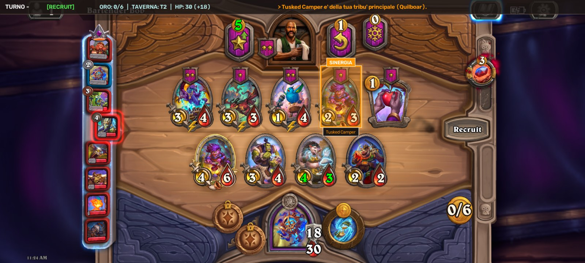

# hs-bg-advisor

Assistente per Hearthstone Battlegrounds: cattura lo schermo del telefono Android (via adb) o analizza screenshot con OpenCV e Tesseract, consigliando in tempo reale le mosse ottimali a terminale o tramite un'**interfaccia grafica a video con overlay in tempo reale**.

**Non invia mai tap o comandi di gioco**: si limita a osservare e consigliare.


---

## Funzionalità Principali

* **Interfaccia Grafica a Video (`--gui`)**: 
  * Finestra ridimensionabile in tempo reale che proietta lo streaming del gioco catturato dal telefono.
  * **Evidenziazione visiva delle carte dello shop** con box colorati, aura e badge:
    * `3x TRIPLA` (oro brillante) per le triple completabili.
    * `★ CORE` (verde smeraldo) con nome della comp per le carte chiave.
    * `+ ADD-ON` (ciano elettrico) per carte di supporto/transizione.
    * `SINERGIA` (arancione) per carte della tribù principale.
  * **Indicatori Taverna & Azioni**: freccia verde `⬆️ SALI TAVERNA`, indicatore `❄️ FREEZE` e `🎲 ROLL`.
  * **Barra HUD Superiore**: turno, fase, oro, livello taverna, salute/armatura e consiglio principale sintetico.



* **Motore Strategico Basato sulle Guide di Jeefhs**:
  * **Curva Standard (Turni 1..5)**:
    * *Turno 1 (3 oro)*: priorità a minion di economia/token da conservare per il Turno 3; divieto assoluto di roll.
    * *Turno 2 (4 oro)*: upgrade obbligatorio a Taverna 2.
    * *Turno 3 (5 oro)*: vendita del token per doppio acquisto a 6 oro (o acquisto 1 pezzo + magia); non salire di taverna e non rollare.
    * *Turno 4 (6 oro)*: doppio acquisto di stabilizzazione per non perdere salute.
    * *Turno 5 (7 oro)*: upgrade obbligatorio a Taverna 3 (curva standard).
  * **Regola "Never Roll Early"**: divieto di rollare nei turni 1-4 per non sacrificare statistiche e vita.
  * **Holding Triples**: valuta il momento migliore per riscattare le triple (es. attendere Taverna 3 o 4 per scoprire minion determinanti di Tier 4 o Tier 5).
  * **Regola del Freeze ("Never freeze for one")**: congela solo per una tripla o per almeno 2 pezzi chiave; mai congelare per una sola carta per non sprecare il refresh gratuito.
  * **Posizionamento Ottimale del Board**: minion con Scudo Divino o Fendente (Cleave) a sinistra; Taunt a destra; motori passivi (*Titus, Brann, Drakkari*) protetti all'estrema destra.
* **Sinergie e Comp HSReplay**:
  * Integrazione con `data/comps.json` (tier, carte core e add-on).

---

## Setup e Requisiti

1. **Telefono Android**: attiva *Opzioni sviluppatore > Debug USB*, collega il PC via cavo. Il comando `adb devices` deve mostrare il dispositivo connesso.
2. **Dipendenze Python**:
   ```bash
   pip install -r requirements.txt
   ```
   *(e installa `tesseract-ocr` dal gestore pacchetti di sistema se desideri il supporto OCR completo).*
3. **Database carte**:
   * `cards.json` (279 carte) e illustrazioni in `data/card_art/<id>.jpg` (o `$HS_BG_CARD_ART`).
   * Per rigenerarli: `python tools/build_card_db.py` (richiede connessione internet).

---

## Come Avviare

### 1. In partita reale (con il telefono collegato)
```bash
# Modalità interfaccia grafica a video (finestra con overlay e HUD)
python main.py --gui

# Oppure modalità classica solo testo a terminale
python main.py
```
*(Se hai più dispositivi Android collegati: aggiungi `--serial <ID>`)*.

### 2. Modalità Demo / Test (senza telefono)
Puoi testare l'advisor e l'interfaccia grafica su qualunque screenshot:
```bash
python main.py --gui --image tests/fixtures/turn4_recruit.png
```

> **Controlli Finestra Grafica**:
> * Premi **`q`** (o qualsiasi tasto in modalità `--image`) per chiudere la finestra.
> * La finestra è liberamente ridimensionabile.

---

### 3. Overlay sul telefono (Android)
`python main.py --serve` pubblica lo stato su `http://127.0.0.1:8765/state` per l'app in `android/`
(consigli disegnati sopra il gioco). Istruzioni in [`android/README.md`](android/README.md), piano in
[`docs/ANDROID_PLAN.md`](docs/ANDROID_PLAN.md).

---

## Risoluzione Schermo

Il telefono deve essere orientato in **orizzontale (20:9)**:
* `capture.py` normalizza automaticamente ogni frame a **2000x900**.
* Le coordinate sono definite e calibrate in [`vision/regions.yaml`](vision/regions.yaml).
* Per ricalibrare su un tuo screenshot:
  ```bash
  python tools/calibrate.py shot.png --out calibration.png
  ```

---

## Test di Unità

La suite automatizzata copre riconoscimento della visione, calibrazione, euristica Jeefhs e overlay grafico:

```bash
pytest
```
*(35 test unitari eseguiti in ~7 secondi).*

---

## Strumenti Inclusi

* `tools/calibrate.py shot.png`: genera un'immagine con il reticolo di tutte le regioni calibrate.
* `tools/match_report.py shot.png [...] [--sheet tavola.png]`: report dettagliato del riconoscimento delle carte con tavola illustrazioni.
* `tools/parse_hsreplay_comps.py export.md`: compila la tier list da HSReplay in `data/comps.json`.
* `tools/build_card_db.py`: scarica e compila il database carte da HearthstoneJSON.
