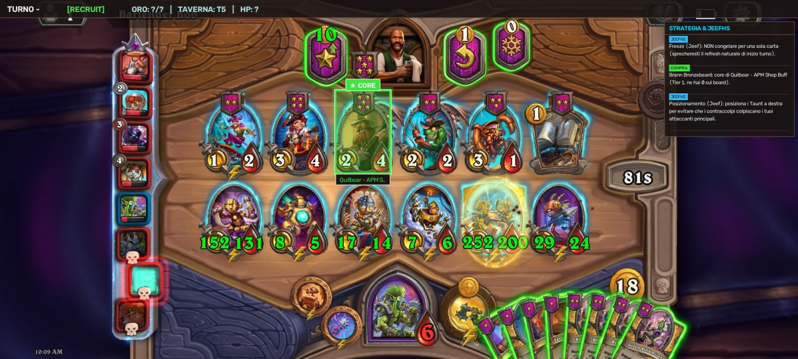

# hs-bg-advisor

Assistente per Hearthstone Battlegrounds: legge lo schermo del telefono Android con OpenCV (cattura via `adb` sul PC, oppure direttamente sul telefono con l'app in `android/`) e consiglia la mossa, a terminale, in una finestra sul PC o con un **overlay sopra il gioco**.

**Non invia mai tap o comandi di gioco**: osserva e consiglia.



---

## Cosa fa

**Lettura dello schermo** (senza OCR esterno, solo OpenCV e template):
- fase (acquisto / combattimento), oro e oro massimo, livello taverna, costo upgrade, vita e armatura;
- carte dello shop (anche incantesimi) e minion del board: nome, tier, tribù, **attacco e vita** (anche a 3 cifre, cifre verdi potenziate);
- il turno si deduce dall'oro massimo (non è sullo schermo).

**Consigli** (`advisor.py`):
- **Curva dei turni 1-5** (guide di Jeefhs): economia/token al turno 1, upgrade a taverna 2 al turno 2 e a taverna 3 al turno 5, doppio acquisto ai turni 3-4.
- **Triple**: segnala la carta che chiude una tripla.
- **Carte chiave delle comp** HSReplay (`data/comps.json`): core e add-on pesati per tier della comp e per quanto hai già sul board.
- **Impegno su comp/tribù**: dal turno 5, con una comp avviata (o dal turno 6 con 3+ minion della stessa tribù), propone solo carte di quella comp e non più core di altre; se nello shop non c'è nulla di utile, suggerisce il roll.
- **Cerca**: in base al board, quali carte aspettare (disponibili ora, poi quelle che richiedono di salire di taverna).
- **Vendita**: a board pieno e con una comp scelta, quale minion fuori comp vendere per fare spazio (mai carte della comp, né minion con 2+ copie).
- **Freeze** quando c'è una tripla da chiudere o almeno 2 carte chiave; sinergie di tribù.
- `actions.py`: elenco delle azioni legali (compra, vendi, gioca, roll, sali, freeze) e loro effetto sullo stato, base per una futura scelta "matematica" della mossa.

---

## Modi di usarlo

| Modo | Dove gira la visione | Dove vedi i consigli |
|---|---|---|
| **PC, solo testo** (`python main.py`) | PC | terminale |
| **PC con finestra** (`--gui`) | PC | finestra con overlay e barra laterale |
| **PC + overlay sul telefono** (`--serve`) | PC | sopra il gioco, sul telefono |
| **Standalone sul telefono** | telefono (Python embedded con Chaquopy) | sopra il gioco, sul telefono |

Le istruzioni per le due modalità Android sono in [`android/README.md`](android/README.md).

---

## Setup del PC

1. **Telefono**: *Opzioni sviluppatore > Debug USB*, collega il cavo. `adb devices` deve mostrarlo (serve `adb`: `sudo apt install adb`).
2. **Python** (3.10+) e dipendenze:
   ```bash
   python3 -m venv .venv && source .venv/bin/activate
   pip install -r requirements.txt
   ```
3. **Database carte**: `cards.json` (279 carte) e le illustrazioni in `data/card_art/<id>.jpg` (o in `$HS_BG_CARD_ART`) servono al riconoscimento. Per rigenerarli: `python tools/build_card_db.py` (richiede internet).

Il telefono deve essere in **orizzontale (20:9)**: `capture.py` porta ogni frame a 2000x900 e le regioni di `vision/regions.yaml` sono calibrate su quella risoluzione.

---

## Avvio

```bash
python main.py                  # consigli a terminale
python main.py --gui            # finestra con overlay e barra dei consigli (q per chiudere)
python main.py --serve          # pubblica lo stato su http://127.0.0.1:8765/state per l'app Android
./run_overlay.sh [--gui]        # tutto in uno per l'overlay sul telefono (adb reverse + app + server)
```

Opzioni: `--serial <ID>` con più telefoni, `--interval <s>` (default 0,7), `--serve-host 0.0.0.0` per il Wi-Fi.

**Demo senza telefono**, su uno screenshot:
```bash
python main.py --gui --image tests/fixtures/turn4_recruit.png
```

In VS Code ci sono dei task pronti (`Ctrl+Shift+P > Tasks: Run Task`): avvio overlay, avvio con finestra, test.

---

## Test

```bash
python -m pytest -q        # 73 test, ~10 secondi, non serve nessun programma esterno
```

## Strumenti (`tools/`)

- `calibrate.py shot.png`: sovrappone allo screenshot le regioni calibrate.
- `match_report.py shot.png [...] [--sheet tavola.png]`: carte riconosciute con punteggio e tavola di controllo.
- `debug_stats.py shot.png`: dove il codice vede le carte e quali attacco/vita legge (per diagnosticare errori sui numeri).
- `parse_hsreplay_comps.py export.md`: aggiorna `data/comps.json` da un export in markdown della tier list HSReplay.
- `build_card_db.py`: scarica carte e illustrazioni da HearthstoneJSON.

## Limiti noti

- La **mano** e lo stato di **freeze** non sono ancora letti dallo schermo.
- Il passo della griglia del board è calibrato con 1-4 minion; con 6-7 minion le posizioni possono essere sfasate (le cifre di attacco e vita si leggono comunque, i nomi potrebbero no).
- I dati delle comp sono quelli dell'ultimo export HSReplay (`_scraped` in `data/comps.json`): vanno aggiornati a ogni patch.
- Un'app di terze parti sopra il gioco non è garantita dalle regole di Blizzard: nessun tap automatico, e un'automazione dei tap renderebbe reale il rischio di ban.

Piano e stato del lavoro Android: [`docs/ANDROID_PLAN.md`](docs/ANDROID_PLAN.md).
